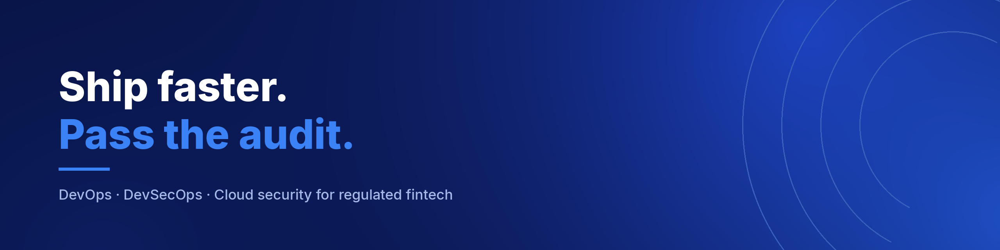

## Senior DevOps & DevSecOps Engineer

**Cloud security & compliance for regulated fintech.**

I build cloud infrastructure and then defend it. Currently founding engineer on a SAMA-regulated payments platform, where I own the GCP estate end to end — Terraform, Kubernetes, CI/CD, SIEM detections, and the compliance evidence behind all of it.

Before that, five years of DevSecOps delivery across banking, healthcare and telecom on AWS, Azure and GCP.

---

## Currently

- 🏗️ Building and defending a **SAMA-regulated payments platform** on GCP — private networking, Terraform IaC, blue-green delivery
- 🔍 Driving **SAMA CSF maturity from Level 2 to Level 3** — control mapping, evidence, audit readiness
- 🛡️ Contributing to **[OWASP www-project-eks-goat](https://github.com/OWASP/www-project-eks-goat)**
- ✍️ Writing **Runs in Production** — system design, security, and lessons from things that actually shipped

---

## What I do

| | |
|---|---|
| **Assess** | Cloud, pipeline and Kubernetes reviewed against production and audit standards |
| **Implement** | Security enforced as a gate, infrastructure defined in code, clusters that hold up under load |
| **Advise** | Ongoing architecture and posture review for teams not ready to hire it full time |

---

## Selected work

| Repo | What it is |
|---|---|
| [**www-project-eks-goat**](https://github.com/adilshehzad786/www-project-eks-goat) | OWASP project — contributed region-aware EKS cleanup |
| [**postgres-gist-500m-lab**](https://github.com/adilshehzad786/postgres-gist-500m-lab) | GiST index behaviour at 500M rows, measured and written up |
| [**AWS-DevOps-Professional**](https://github.com/adilshehzad786/AWS-DevOps-Professional) | Study notes for the AWS DevOps Pro certification |
| [**Study-guide-AZ-400**](https://github.com/adilshehzad786/Study-guide-AZ-400) | Same, for the Microsoft DevOps Engineer track |
| [**Getting-Started-with-GitHub-Actions**](https://github.com/adilshehzad786/Getting-Started-with-GitHub-Actions) | Practical walkthrough of Actions workflows |
| [**Terraform-Using-AWS**](https://github.com/adilshehzad786/Terraform-Using-AWS) | Terraform patterns for AWS infrastructure |

---

## Stack

**Cloud**

**Containers & Infrastructure as Code**

**Delivery & Security**

**Data & Observability**

---

## Certifications

---

**Working on something that has to ship fast and pass an audit?**

